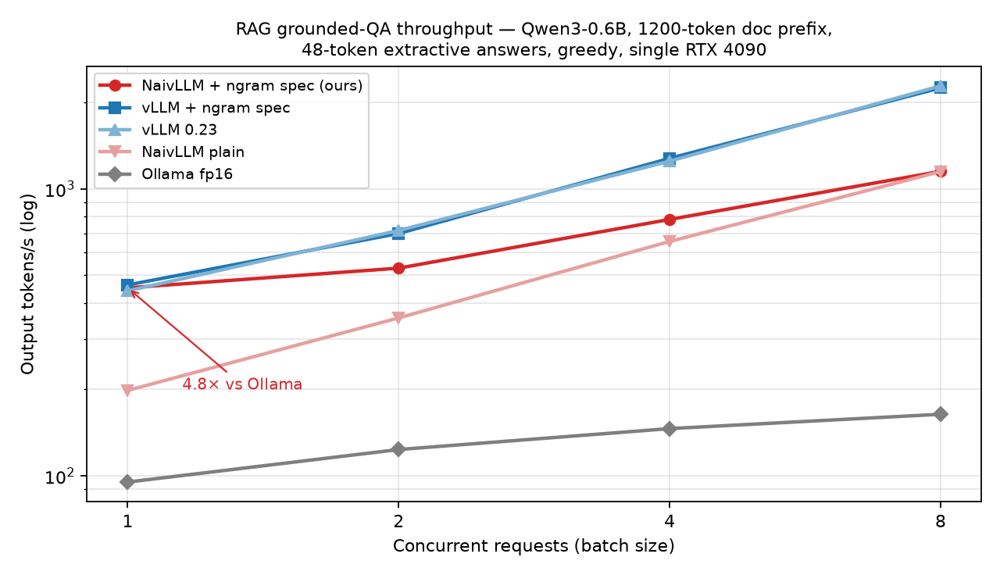
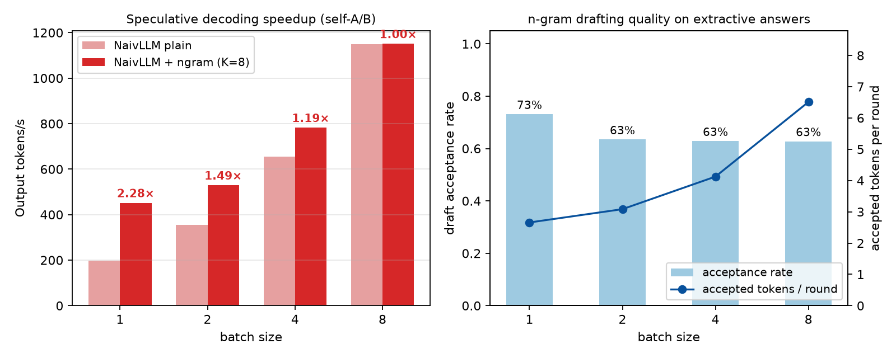
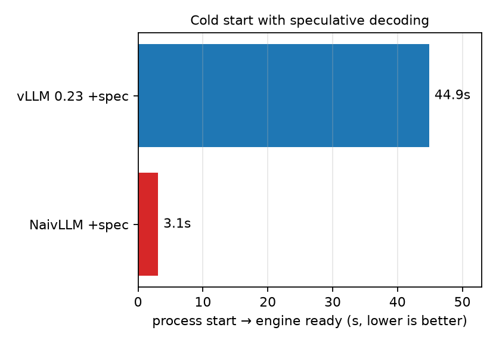

# NaivLLM

A ~3.5k-line Qwen3 inference engine — paged KV cache, continuous batching,
tensor parallelism, Triton attention, CUDA-Graph decode — specialized for one
vertical: **low-latency RAG / knowledge-base QA on a single consumer GPU**.

```
长固定文档前缀  ──►  pinned prefix cache   (warm TTFT)
短抽取式回答    ──►  n-gram 投机解码        (2.3× decode, lossless)
每轮验证        ──►  verify CUDA Graph     (one replay per round)
```

## Results — RAG grounded QA, single RTX 4090

Qwen3-0.6B (bf16/fp16) · 1200-token shared doc prefix · 48-token extractive
answers · greedy · identical prompts/weights/GPU · 3-run median.
vLLM gets its own ngram speculative decoding with the same K=8 and n-gram
bounds; Ollama runs fp16 on a dedicated GPU-pinned server.

| batch | NaivLLM plain | **NaivLLM +ngram** | vLLM 0.23 | vLLM +ngram | Ollama |
|------:|--------------:|-------------------:|----------:|------------:|-------:|
| 1     | 198 tok/s    | **452 tok/s**      | 441       | 463         | 95     |
| 2     | 355          | **529**            | 716       | 699         | 124    |
| 4     | 656          | 782                | 1249      | 1277        | 146    |
| 8     | 1148         | 1151               | 2285      | 2248        | 164    |
| cold start | —       | **3.1 s**          | 44.9 s    | 44.9 s      | resident |



- **vs Ollama (the single-user small-model baseline): 4.8×–7.0× across every
  batch size.** Ollama has no ngram spec decoding and no smaller Qwen3 draft
  exists for 0.6B, so this is its best available configuration.
- **vs vLLM:** single-request latency (batch 1) is on par with both vLLM and
  vLLM+ngram (452 / 441 / 463 — within noise of each other); vLLM's
  continuous batching wins batch ≥ 2 throughput. **Cold start is 14.5×
  faster (3.1 s vs 44.9 s)** — the number that matters for on-demand /
  scale-to-zero knowledge-base deployments.
- Speculative decoding is exactly **lossless**: greedy spec output is
  token-identical to the engine's own plain decode (verified in CI script).




## Speculative decoding (`myvllm/spec_engine`)

Lossless speculative decoding (Leviathan et al. 2023), mirroring vLLM's
methods, with pluggable drafters:

| drafter | how it drafts | best for |
|---------|---------------|----------|
| `NgramDrafter` | n-gram match over prompt+output via `bytes.rfind` (no draft model) | extractive RAG — 63–90% acceptance measured |
| `ModelDrafter` | smaller Qwen3 runs K decode steps through its own paged KV + CUDA graphs | general workloads |

Verification = one multi-token forward over `[last_confirmed, d_1..d_K]`
through a dedicated Triton paged-attention kernel (per-row causal mask),
**replayed as a captured CUDA graph** per batch bucket. Rejection sampling
supports greedy exact-match, `min(1, p_t/p_d)` + residual resample, and a
distribution-free accept-if-equals-target-sample rule — all provably
lossless. Drafted tails roll back in sequence + block tables (`trim_to`).

## Bug fixes over the original codebase (12)

Correctness: fully-cached-prompt `q_len=0` misalignment · CUDA-tensor leak
into CPU token bookkeeping (crashed the original on this stack) · oversized
CUDA-graph replay + stale-tail `slot_mapping` polluting KV slot 0 (decode
degenerated to token 0) · bf16 accumulation in the decode kernel flipping
argmax on flat top-2 · Qwen3 q/k-norm wrongly gated on `qkv_bias` · rms eps
never wired to LayerNorms · qkv-bias weights silently dropped · TP loading
bypassed `weight_loader` (TP>1 crashed).
Robustness: scheduler dropped sequences on preempt/limit-break paths ·
verify-graph `cu_seqlens` freed after capture (dangling device pointer) ·
RowParallel bias double-counted under TP · sampler now supports greedy
(T=0). Full list in the commit history.

## Quickstart

```bash
pip install -e . && python main.py          # plain demo (Qwen3-0.6B)
PYTHONPATH=src python spec_main.py \
    --model /models/Qwen3-0.6B --method ngram --k 8 --temperature 0
PYTHONPATH=src python scripts/check_hf_alignment.py \
    --model /models/Qwen3-0.6B              # losslessness check (PASS)
```

## Reproduce the benchmark

```bash
# dedicated ollama on the same GPU (fp16, raw prompts, bounded KV)
CUDA_VISIBLE_DEVICES=1 OLLAMA_HOST=127.0.0.1:11435 OLLAMA_MODELS=~/ollama-gpu1/models \
  OLLAMA_KEEP_ALIVE=-1 OLLAMA_NUM_PARALLEL=8 OLLAMA_CONTEXT_LENGTH=4096 ollama serve &
OLLAMA_HOST=127.0.0.1:11435 ollama pull qwen3:0.6b-fp16

PYTHONPATH=src python benchmarks/rag_bench.py \
  --model /models/Qwen3-0.6B --gpu 1 \
  --backends naivllm,vllm-spec,vllm,ollama --batches 1,2,4,8 \
  --doc-tokens 1200 --max-tokens 48 --repeats 3 --k 8 \
  --naiv-method ngram --ollama-model qwen3:0.6b-fp16
PYTHONPATH=src python benchmarks/plot_results.py    # charts into docs/
```

Raw result JSONs live in `benchmark-results/`; each backend runs in its own
process on the same GPU.

## Layout

Deep dives: **[docs/TECHNICAL.md](docs/TECHNICAL.md)** (architecture +
code walkthrough, 简体中文) · **[docs/INTERVIEW.md](docs/INTERVIEW.md)**
(infra-interview cheat sheet, 简体中文) · **[docs/INTERVIEW-QA.md](docs/INTERVIEW-QA.md)**
(interview Q&A with beginner-friendly deep explanations, 简体中文).

```
src/myvllm/engine/     scheduler, block manager (prefix cache/pin/trim), model
                       runner (decode+verify CUDA graphs), LLMEngine
src/myvllm/layers/     Triton attention (varlen prefill / paged decode /
                       multi-query verify), TP linears, RoPE, sampler
src/myvllm/models/     Qwen3
src/myvllm/spec_engine/ SpecLLMEngine, Ngram/Model drafters, rejection sampler
benchmarks/            rag_bench.py (3-way), narrow_regime.py, plot_results.py
scripts/               hf-alignment check + numeric/graph debug probes
tests/                 CPU unit tests (scheduler/block-manager invariants)
```

## Honest scope

One GPU, Qwen3 0.6B–3B, batch 1–8, decode-bound RAG traffic is where NaivLLM
is competitive: it beats Ollama everywhere, matches vLLM at batch 1, and
loses to vLLM's batching at batch ≥ 2 — measure the crossover on your own
hardware rather than trusting fixed claims. Qwen3 is the only supported
architecture; prefix-reuse prefill uses a correctness-oriented PyTorch path.
